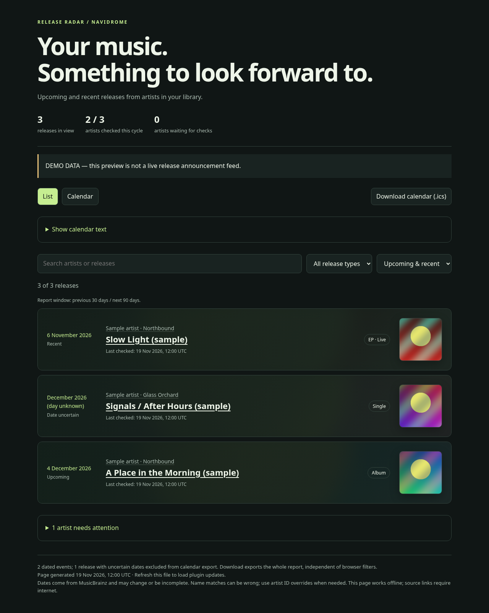

# Upcoming Releases for Navidrome

> [!IMPORTANT]
> **AI development notice**
> This project is developed with **OpenAI Codex**, under human direction. Its implementation and tests are AI-assisted; changes should receive human review.

Keep up with new music from the artists already in your Navidrome library.

**Local dashboard · Month calendar · iCalendar export · ntfy alerts · Google Calendar / CalDAV sync**

## What it does

- Finds upcoming and recent releases using the free MusicBrainz API.
- Lets you choose release types and optionally hide music already in your library.
- Generates an offline HTML dashboard with search, filters and a calendar that fits mobile screens.
- Optionally embeds cover art for offline viewing, with a subtle card background.
- Exports `.ics` files and optionally sends notifications or syncs a calendar.
- Saves progress, retries failed lookups and updates events when release dates change.

**No additional web server, public page, or file-download endpoint.** Reports stay in local files; external integrations only connect to destinations you configure. Notifications and calendar sync are off by default. No paid API is required.

## Get started

1. [Download the plugin](https://github.com/JLS1996/navidrome-upcoming-releases-plugin/raw/main/dist/release-radar.ndp) or [build it](docs/development.md#build).
2. Copy it into Navidrome's plugins folder and rescan plugins.
3. Grant access to one user and the intended libraries, then enable it.
4. Open the generated HTML file locally. [Installation and file access →](docs/installation.md)

Local files are created under `<DataFolder>/plugins/release-radar/storage/`. Running Navidrome as a different OS user may require host-side file sharing.

## Documentation

| | |
|---|---|
| [Installation](docs/installation.md) | Native installs, Docker and local file permissions |
| [Configuration](docs/configuration.md) | Release filters and artist matching |
| [Calendars & notifications](docs/integrations.md) | `.ics`, ntfy, Google Calendar and CalDAV |
| [Privacy & security](SECURITY.md) | Outbound-only design and handling credentials |
| [Development](docs/development.md) | Build, test and contribute |
| [Known limitations](docs/limitations.md) | Coverage, dates and deployment checks |

## Contributing

Bug reports and pull requests are welcome. Include a reproducible example and redact credentials, account identifiers and personal library details. Please keep AI-assisted changes clearly disclosed and covered by relevant tests.

[MIT licensed](LICENSE). Dependency notices are in [THIRD_PARTY_NOTICES.md](THIRD_PARTY_NOTICES.md).
